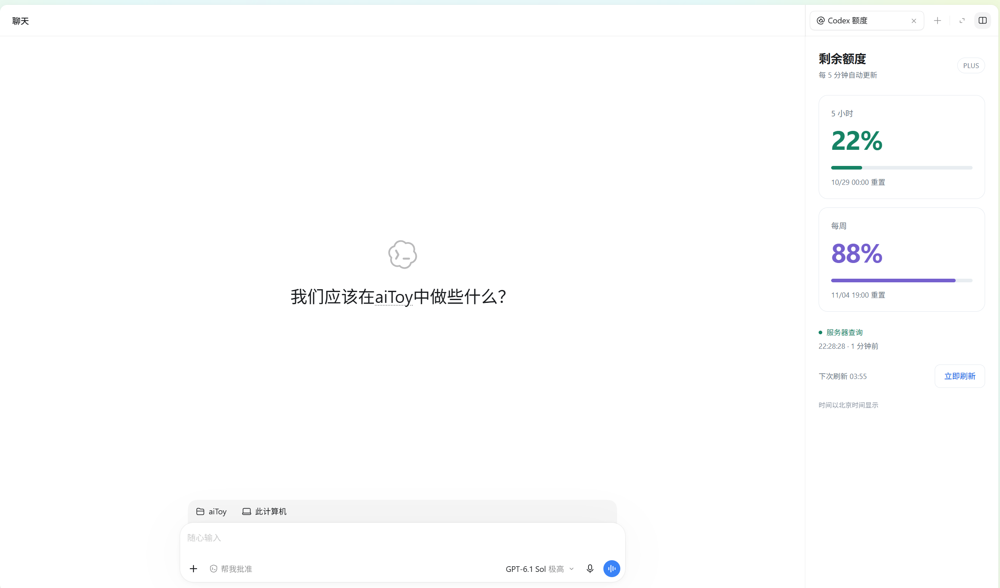

# Codex 额度面板

在 **Codex 聊天右侧**查看当前账号的 5 小时和每周剩余额度，支持自动更新与手动刷新。

这是一个个人开发的 Windows 本地插件，使用 MCP Apps 对话侧面板扩展，不是 OpenAI 官方产品。



## 功能

- 显示 5 小时／每周**剩余百分比**、重置时间和套餐。
- 面板可见时每 **5 分钟**自动刷新，也可点击“立即刷新”。
- 标明数据来自服务器查询还是本机记录，并显示原始记录时间。
- 旧记录超过重置时间后显示“待更新”，不会假定恢复为 100%。
- 跟随宿主明暗主题，适配窄侧栏和较宽的独立看板。

## 运行环境

- Windows 10 / 11，.NET Framework 4.8。
- 已安装并登录 Codex，且当前桌面版本支持 MCP Apps 对话侧面板。
- Node.js **22 或更高版本**，终端可运行 `node --version`。
- Codex CLI，终端可运行 `codex --version`。

目前仅支持 Windows。查询组件以预编译的 `QuotaReader.exe` 随包提供，不需要额外 API Key。

## 安装

仓库已经包含构建好的插件，正常使用**不需要先安装 npm 依赖或编译**。

在 PowerShell 中运行：

```powershell
codex plugin marketplace add voniat/codex-quota-panel
codex plugin add codex-quota-panel@local-quota
```

安装后，在聊天右上角的内容页 **＋ → Codex 额度** 打开侧栏。也可以在聊天中请求“打开额度面板”。左侧导航的“额度看板”提供独立看板入口。

如果入口没有立即出现，重启 Codex 后查看。每个聊天拥有独立的面板实例，首次使用时需要打开入口。

[下载插件 ZIP](https://github.com/voniat/codex-quota-panel/releases/latest/download/codex-quota-panel.zip) · [查看 Releases](https://github.com/voniat/codex-quota-panel/releases)

ZIP 是独立插件包；首次安装推荐使用上面的仓库来源命令。

## 刷新与用量

插件通过本机 Codex 的 `account/rateLimits/read` 接口读取额度，**不会为每次刷新发起模型对话**。查询失败时，会尝试读取带原始时间的本机会话记录；没有可用记录时提示重试。

隐藏面板时暂停定时查询，再次显示后会补做已经到期的刷新。重复点击会合并正在进行的请求。

工具说明与最新额度可能为后续聊天增加少量上下文，因此不承诺“绝对零额度消耗”。

登录与鉴权由本机 Codex 处理。此项目不打包登录凭证，不把额度数据发送到项目作者的服务器。

## 本地开发

```powershell
git clone https://github.com/voniat/codex-quota-panel.git
cd codex-quota-panel
npm ci
npm run build
npm test
npm run package
```

构建结果在 `plugins/codex-quota-panel/`，ZIP 输出到 `dist/codex-quota-panel.zip`。

前端与 MCP 服务源码位于 `src/`；Windows 查询器目前以预编译组件保存在 `native/`。第三方组件许可说明见 [THIRD_PARTY_NOTICES.md](plugins/codex-quota-panel/THIRD_PARTY_NOTICES.md)。

## 项目结构

```text
.agents/plugins/marketplace.json  本地插件来源
src/                              界面与 MCP 服务源码
test/                             数据处理和协议测试
scripts/                          构建与打包脚本
native/QuotaReader.exe             Windows 查询组件
plugins/codex-quota-panel/         可直接安装的插件
docs/screenshot.png               界面示意图
```

可在 Codex 的插件设置中停用或卸载“Codex 额度”。本项目不修改 Codex 程序文件，也不添加系统开机启动项。
